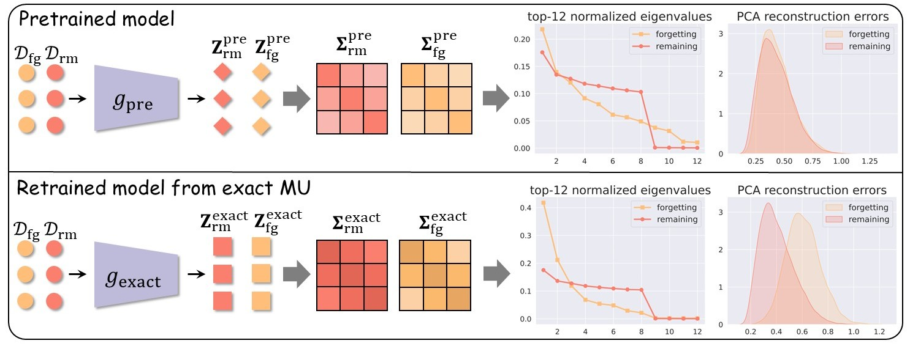
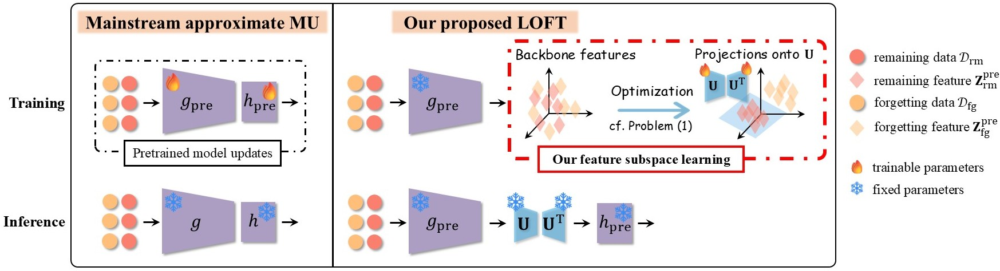

# Machine Unlearning in Low-Dimensional Feature Subspace
This is the official PyTorch implementation of the NeurIPS'26 paper: *Machine Unlearning in Low-Dimensional Feature Subspace* ([arxiv](https://arxiv.org/abs/2601.22456)).

If our work is helpful to your research, welcome to cite our paper!
```
@misc{fang2026loft,
title={Machine Unlearning in Low-Dimensional Feature Subspace}, 
author={Kun Fang and Qinghua Tao and Junxu Liu and Yaxin Xiao and Yulin Jin and Qingqing Ye and Jian Sun and Haibo Hu},
year={2026},
eprint={2601.22456},
archivePrefix={arXiv},
primaryClass={cs.LG},
url={https://arxiv.org/abs/2601.22456}, 
}
```

## Summary

We take a **low-dimensional feature subspace** perspective on machine unlearning and propose **LOFT** for learning **LO**w-dimensional **F**ea**T**ure subspaces as an approximate machine unlearning method.

LOFT is motivated by spectrum and reconstruction analyses into the low-dimensionality property of the features from the pretrained and retrained models. After exact retraining on the remaining data, a low-dimensional subspace fitted to the remaining features reconstructs them much better than it reconstructs the forgetting features. This difference is considerably weaker in the pretrained model. Inspired by this, we seek to **learn a feature subspace from the pretrained model** that preserves dominant variation of remaining data, while suppressing information associated with forgetting data, thereby achieving effective unlearning on the pretrained model.

<a href="pics/fig_spectrum.jpg"><div align="center"></div></a>

Given the pretrained model and the remaining and forgetting feature covariances ${\mathbf\Sigma}^{\rm pre}_ {\rm fg}$ and ${\bf\Sigma}^{\rm pre}_ {\rm rm}$, LOFT optimizes a projection matrix $\bf U$ within the Stiefel manifold ${\rm St}(d,s)$ in the following form.

$$
\min_ {{\bf U}\in{\rm St}(d,s)}
{J}({\bf U})=\underbrace{
\Bigl(
\frac
{{\rm Tr}({\bf U}^\top{\bf\Sigma}^{\rm pre}_ {\rm fg}{\bf U})}
{{\rm Tr}({\bf\Sigma}^{\rm pre}_ {\rm fg})}
\Bigr)^2}_ {{\cal J}_ {\rm fg}}
+
\underbrace{
\Bigl(
\frac
{{\rm Tr}\left({\bf\Sigma}^{\rm pre}_ {\rm rm}-{\bf U}{\bf U}^\top{\bf\Sigma}^{\rm pre}_ {\rm rm}{\bf U}{\bf U}^\top\right)}
{{\rm Tr}\left({\bf\Sigma}^{\rm pre}_ {\rm rm}\right)}
\Bigr)^2}_ {{\cal J}_ {\rm rm}}.
$$

- ${\cal J}_ {\rm fg}$ quantifies the projection variance of the forgetting features onto the subspace spanned by $\bf U$. Minimizing ${\cal J}_ {\rm fg}$ encourages $\bf U$ to capture minimal information of forgetting features, aiming to forget the knowledge of forgetting data.
- ${\cal J}_ {\rm rm}$ measures the projection variance of the remaining features captured within the complement subspace w.r.t. $\bf U$. Minimizing ${\cal J}_ {\rm rm}$ forces $\bf U$ to preserve maximal information of remaining features, so as to maintain model performance on remaining data.


LOFT has two main advantages:
- **One-shot feature fetching.** Training features can be fetched and cached in a single forward pass before unlearning requests arrive. For each request, LOFT computes the two covariances from the cached features and optimizes $\bf U$ without revisiting the raw training data.
- **Plug-in module implementation.** At inference time, LOFT inserts the learned projector $\bf UU^\top$ between the backbone and classifier. The pretrained model stays frozen, and each request requires storing only its own projection matrix.


<a href="pics/fig_intro.jpg"><div align="center"></div></a>

## Pre-requisite

The required packages are listed in `requirements.txt`

## Running

To reproduce results reported in our paper, we kindly suggest the following steps.

Step.1. Run the `run_pretrain.sh` to obtain pretrained models used in the paper
```
bash run_pretrain.sh
```
Step.2. Run the `run_subspace.sh` to execute our subspace unlearning
```
bash run_subspace.sh
```
**Note**: If you would like to adapt our LOFT to configurations that differ from those in our paper, e.g., different pretrained models, datasets, or unlearning settings, <u>*please be sure to re-tune relevant hyper-parameters carefully to achieve satisfactory performance*</u>. We particularly recommend several key hyper-parameters: the subspace dimension `--subspace_s`, the optimization steps `--subspace_steps`, and the learning rate `--unlearn_lr`.

---
If u have problems abou the code or paper, u could contact me (fanghenshao97@outlook.com) or raise issues here.

If the code benefits ur researches, welcome to fork and star ⭐ this repo! :)